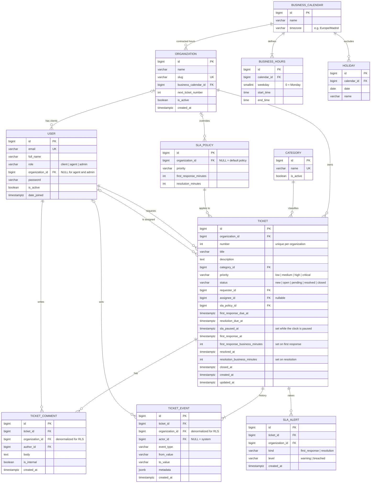

# Data model

This document describes the PostgreSQL data model of HelpDesk SLA: entities,
relationships, integrity constraints, initial indexes and Row-Level Security policies.

## Entity-relationship diagram

## Entities

| Entity | Purpose | Design notes |
|---|---|---|
| `organization` | A client company. | Linked to the business calendar it contracted. `next_ticket_number` provides per-client ticket numbers (e.g. `ACME-42`). |
| `user` | Anyone using the system. | Custom user model from the first migration. Clients belong to an organization; agents and admins belong to the support provider and have no organization. |
| `category` | Ticket classification. | Global catalog managed by admins. |
| `business_calendar` | Contracted support hours. | Holds the time zone used to evaluate business hours. |
| `business_hours` | Working time slots per weekday. | Several rows per day allow split shifts. |
| `holiday` | Non-working days. | Belong to a calendar, so each client can have its own regional holidays. |
| `sla_policy` | Deadlines per priority. | `organization_id = NULL` is the default policy; a non-null value is a client-specific agreement. |
| `ticket` | The incident. | Stores the computed SLA deadlines (`*_due_at`), the start of the current pause, the key timestamps and the business minutes consumed until the first response and the resolution (see ADR-0002). |
| `ticket_comment` | Ticket conversation. | `is_internal` marks agent-only notes. |
| `ticket_event` | Change history. | Append-only. `actor_id = NULL` means a system action, such as an `sla_recalculated` event after a calendar change. |
| `sla_alert` | Alerts already raised. | Its unique key guarantees each alert is raised only once. |

## Integrity constraints

| Table | Constraint | Guarantees |
|---|---|---|
| `user` | `CHECK ((role = 'client') = (organization_id IS NOT NULL))` | Role and organization are consistent. |
| `ticket` | `CHECK` on `priority` and `status` values | Valid values even when writing outside Django. |
| `ticket` | `CHECK (status <> 'closed' OR closed_at IS NOT NULL)`, same idea for `resolved_at` | Timestamps match the status. |
| `ticket` | `CHECK ((first_response_at IS NULL) = (first_response_business_minutes IS NULL))`, same idea for `resolved_at` and `resolution_business_minutes` | A business duration exists only when its timestamp does. |
| `ticket` | `UNIQUE (organization_id, number)` | Unique ticket numbers per client. |
| `ticket` | `UNIQUE (id, organization_id)` | Target for the composite foreign keys below. |
| `ticket_comment`, `ticket_event`, `sla_alert` | `FOREIGN KEY (ticket_id, organization_id) REFERENCES ticket (id, organization_id)` | The denormalized `organization_id` can never contradict the ticket's. Created with `RunSQL`, since Django does not support composite foreign keys. |
| `sla_policy` | `UNIQUE NULLS NOT DISTINCT (organization_id, priority)` | Only one default policy per priority (PostgreSQL 15+). |
| `sla_policy` | `CHECK (resolution_minutes >= first_response_minutes AND first_response_minutes > 0)` | Sensible deadlines. |
| `business_hours` | `CHECK (start_time < end_time)`, `CHECK (weekday BETWEEN 0 AND 6)` | Valid time slots. |
| `holiday` | `UNIQUE (calendar_id, date)` | No duplicated holidays. |
| `sla_alert` | `UNIQUE (ticket_id, kind, level)` | Idempotent alerts with `INSERT ... ON CONFLICT DO NOTHING`. |

## Initial indexes

These are a first proposal. They will be validated with `EXPLAIN ANALYZE` against
realistic seed data in phase 8.

| Index | Supports |
|---|---|
| `ticket (organization_id, status)` | Client ticket list filtered by status. |
| `ticket (assignee_id, status)` | Agent work queue and workload statistics. |
| `ticket (resolution_due_at) WHERE status IN ('new', 'open')` | Partial index for the background job that looks for tickets about to breach. |
| `ticket (first_response_due_at) WHERE first_response_at IS NULL` | Same, for the first-response SLA. |
| `ticket (created_at)` | Monthly aggregations in the dashboard. |
| `ticket_comment (ticket_id, created_at)` | Ordered comment thread. |
| `ticket_event (ticket_id, created_at)` | Ticket history. |

## Row-Level Security

The application connects as `helpdesk_app`, a role that does not own the tables and
lacks `BYPASSRLS`. Migrations run as `helpdesk_owner`. `FORCE ROW LEVEL SECURITY` is
enabled so that even the owner is subject to the policies.

After the JWT is validated, each transaction sets its context with
`set_config('app.org_id', ..., true)` and `set_config('app.role', ..., true)`.
The third argument scopes the value to the current transaction, which keeps it safe
with connection pooling. If the context is missing, the policies match no rows:
the system fails closed.

| Table | Policy |
|---|---|
| `ticket` | Staff (agent or admin) see every row. Clients see rows of their own organization. |
| `ticket_comment` | Same as `ticket`, and clients never see rows with `is_internal = true`. |
| `ticket_event` | Same as `ticket`. `UPDATE` and `DELETE` are revoked from the application role. |
| `organization` | Clients see only their own organization. |
| `user` | Clients see users of their organization plus staff (to display the assignee). |
| `sla_alert` | Staff only. |
| Catalogs | `category`, calendars and `sla_policy` have no RLS; the application role has read-only access. |

The application still filters by organization in its querysets. RLS is a second line
of defense, and the explicit filter also helps the query planner.
