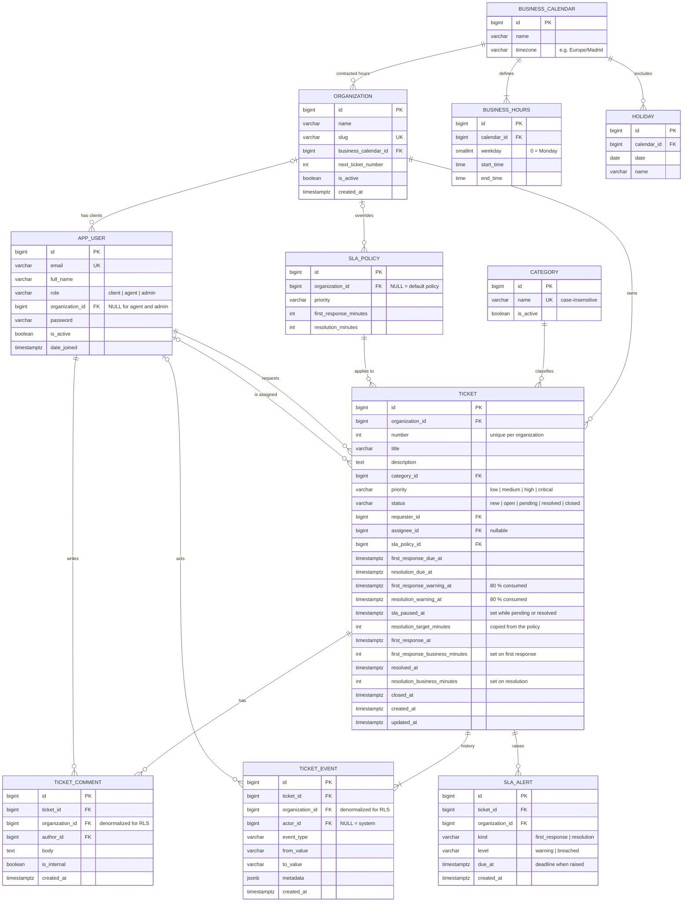

# Data model

This document describes the PostgreSQL data model of HelpDesk SLA: entities,
relationships, integrity constraints, indexes and Row-Level Security policies.

## Entity-relationship diagram

## Entities

| Entity | Purpose | Design notes |
|---|---|---|
| `organization` | A client company. | Linked to the business calendar it contracted. `next_ticket_number` provides per-client ticket numbers (e.g. `ACME-42`). |
| `app_user` | Anyone using the system. | Custom user model from the first migration. Named `app_user` because `user` is a reserved word in PostgreSQL. Clients belong to an organization; agents and admins belong to the support provider and have no organization. |
| `category` | Ticket classification. | Global catalog managed by admins. |
| `business_calendar` | Contracted support hours. | Holds the time zone used to evaluate business hours. |
| `business_hours` | Working time slots per weekday. | Several rows per day allow split shifts. |
| `holiday` | Non-working days. | Belong to a calendar, so each client can have its own regional holidays. |
| `sla_policy` | Deadlines per priority. | `organization_id = NULL` is the default policy; a non-null value is a client-specific agreement. |
| `ticket` | The incident. | Stores the computed SLA deadlines (`*_due_at`), the start of the current pause, the key timestamps and the business minutes consumed until the first response and the resolution (see ADR-0002). |
| `ticket_comment` | Ticket conversation. | `is_internal` marks agent-only notes. |
| `ticket_event` | Change history. | Append-only. `actor_id = NULL` means a system action, such as an `sla_recalculated` event after a calendar change. |
| `sla_alert` | Alerts already raised. | Its unique key guarantees each alert is raised only once, so there is at most one warning per ticket and kind even if the deadline is later extended. `due_at` keeps the deadline that triggered the alert, since the ticket's deadline may move afterwards. |

## Integrity constraints

Every enumerated column (`role`, `priority`, `status`, `event_type`, `kind`, `level`)
is a `varchar` with a `CHECK` on its allowed values, so values stay valid even when
writing outside Django. They are not repeated in the table below.

| Table | Constraint | Guarantees |
|---|---|---|
| `organization` | `UNIQUE (slug)`, `CHECK (slug ~ '^[a-z0-9]+(-[a-z0-9]+)*$')`, `CHECK (next_ticket_number >= 1)` | Unique, URL-safe client codes for ticket references; ticket numbers start at 1. |
| `app_user` | `CHECK ((role = 'client') = (organization_id IS NOT NULL))` | Role and organization are consistent. |
| `app_user` | `UNIQUE (email)`, `CHECK (email = lower(email))`, `CHECK (email <> '')` | Case-insensitive unique emails: they are stored lowercase, so a plain unique index is enough. |
| `app_user` | `CHECK (NOT is_staff OR role <> 'client')` | Clients never access the Django admin. |
| `app_user` | `UNIQUE (id, organization_id)` | Target for the requester composite foreign key. |
| `category` | `UNIQUE (lower(name))` | No duplicated categories differing only in case; the name keeps the case it was typed with. |
| `business_hours` | `CHECK (start_time < end_time OR end_time = '00:00')`, `CHECK (weekday BETWEEN 0 AND 6)` | Valid time slots. As an end, `00:00` means 24:00: `22:00-00:00` is a night shift until midnight and `00:00-00:00` a whole day, so a 24/7 calendar is seven of them. A shift that crosses midnight is two slots, one on each day. |
| `business_hours` | `EXCLUDE USING gist (calendar_id WITH =, weekday WITH =, tsrange(...) WITH &&)` | Slots of the same calendar and weekday never overlap, so business minutes are not counted twice. Adjacent slots (09-14, 14-18) are allowed. Needs the `btree_gist` extension; times are placed on a fixed date because PostgreSQL has no time range type, and an end of `00:00` on the next date. |
| `holiday` | `UNIQUE (calendar_id, date)` | No duplicated holidays. |
| `sla_policy` | `UNIQUE NULLS NOT DISTINCT (organization_id, priority)` | Only one default policy per priority (PostgreSQL 15+). |
| `sla_policy` | `CHECK (resolution_minutes >= first_response_minutes AND first_response_minutes > 0)` | Sensible deadlines. |
| `ticket` | `UNIQUE (organization_id, number)`, `CHECK (number >= 1)` | Unique ticket numbers per client. |
| `ticket` | `UNIQUE (id, organization_id)` | Target for the composite foreign keys of comments, events and alerts. |
| `ticket` | `FOREIGN KEY (requester_id, organization_id) REFERENCES app_user (id, organization_id)` | The requester is a client of the ticket's organization (staff have no organization, so they never match). Created with `RunSQL`. |
| `ticket` | `CHECK ((status = 'closed') = (closed_at IS NOT NULL))`, `CHECK ((status IN ('resolved', 'closed')) = (resolved_at IS NOT NULL))` | Timestamps match the status in both directions: no missing timestamps and no leftover ones (reopening clears `resolved_at`). |
| `ticket` | `CHECK ((first_response_at IS NULL) = (first_response_business_minutes IS NULL))`, same idea for `resolved_at` and `resolution_business_minutes` | A business duration exists only when its timestamp does. |
| `ticket` | `CHECK ((status IN ('pending', 'resolved')) = (sla_paused_at IS NOT NULL))` | The resolution clock is paused exactly in `pending` and `resolved`. In `closed` it is stopped for good, so there is no pause to resume. |
| `ticket` | `CHECK (first_response_warning_at <= first_response_due_at)`, same for the resolution | The instants at which 80 % of each deadline's business time is consumed, used by the SLA alerts job. Derived data, rewritten with the deadlines by the ticket services; a warning can never come after its deadline. |
| `ticket` | `CHECK (resolution_target_minutes > 0)` | The business minutes the resolution may take, copied from the policy on creation (and adjusted on priority changes). A copy, like the price on an order line: editing a policy does not change what open tickets were promised, and it keeps `resolution_business_minutes = target - minutes left until resolution_due_at` exact. |
| `ticket` | `CHECK (first_response_business_minutes >= 0 AND resolution_business_minutes >= 0)` | No negative durations. `NULL` passes: a `CHECK` only rejects a condition that is false, not unknown. |
| `ticket_comment`, `ticket_event`, `sla_alert` | `FOREIGN KEY (ticket_id, organization_id) REFERENCES ticket (id, organization_id)` | The denormalized `organization_id` can never contradict the ticket's. Created with `RunSQL`, since Django does not support composite foreign keys. They replace the simple foreign keys to `ticket` and `organization` (`db_constraint=False` in Django). Not deferrable, so the offending `INSERT` fails at once; `ON UPDATE` / `ON DELETE NO ACTION`, so a ticket can be neither moved to another organization nor deleted. |
| `ticket_comment` | `CHECK (body ~ '\S')` | No empty or whitespace-only comments. |
| `ticket_event` | `CHECK (jsonb_typeof(metadata) = 'object')` | `metadata` is always a JSON object. |
| `ticket_event` | `CHECK (from_value <> '' AND to_value <> '')` | `NULL` is the only way to say "no value". |
| `sla_alert` | `UNIQUE (ticket_id, kind, level)` | Idempotent alerts with `INSERT ... ON CONFLICT DO NOTHING`; `RETURNING id` yields a row only for a new alert, which is the only case that sends a notification. |

`backend/tests/test_schema.py` compares this catalog with the models: every constraint
in the database must be declared in a model or be one of the four composite foreign
keys listed in the test, and the other way round.

## Indexes

Proposed with the schema and reviewed in phase 8 with `EXPLAIN ANALYZE` on 200,000
tickets: one index was added (the last row of the table) and the rest were kept. The
measurements, and what was tried and left out, are in
[Analytics: Performance](analytics.md#performance).

Django indexes every foreign key by default. `ticket.organization_id` and
`ticket.assignee_id` have no index of their own: `UNIQUE (organization_id, number)` and
`(assignee_id, status)` start with those columns and serve the same lookups. The same
applies to `ticket_id` in `ticket_comment` and `ticket_event`, covered by their
`(ticket_id, created_at)` indexes, and in `sla_alert`, covered by its unique
`(ticket_id, kind, level)` index. `business_hours` keeps the automatic B-tree index on
`calendar_id` next to the GiST index of its exclusion constraint, which also starts with
`calendar_id`: the GiST operator class only compares `bigint` with `bigint`, and Django
sends the id as an `integer`, so only the B-tree serves that lookup.

| Index | Supports |
|---|---|
| `ticket (organization_id, status)` | Client ticket list filtered by status. |
| `ticket (assignee_id, status)` | Agent work queue and workload statistics. |
| `ticket (resolution_due_at) WHERE status IN ('new', 'open')` | Partial index for the background job that looks for tickets about to breach. |
| `ticket (first_response_due_at) WHERE first_response_at IS NULL` | Same, for the first-response SLA. |
| `ticket (resolution_warning_at) WHERE status IN ('new', 'open')` and `ticket (first_response_warning_at) WHERE first_response_at IS NULL` | The same partial conditions, for the warning alerts. |
| `ticket (resolved_at, id) WHERE status = 'resolved'` | Auto-close job: resolved tickets past the client's window, read in batches with keyset pagination on `(resolved_at, id)`. Partial because closed tickets accumulate forever while resolved ones are few. |
| `ticket (created_at)` | Staff ticket list, newest first, and the category trends of the dashboard. |
| `ticket_comment (ticket_id, created_at)` | Ordered comment thread. |
| `ticket_event (ticket_id, created_at)` | Ticket history. |
| `ticket_event (organization_id, created_at)` | A client's whole history, which the daily backlog of the dashboard reads (added in phase 8, created concurrently). |

## Database roles and table privileges

Two roles, created by `docker/postgres/roles.sql` (run as a superuser, idempotent):

- `helpdesk_owner` owns the database and every table and runs the migrations
  (`DATABASE_OWNER_URL`, given only to the process that migrates).
- `helpdesk_app` is used by Django at runtime (`DATABASE_URL`). It owns nothing and
  lacks `BYPASSRLS`.

Privileges of `helpdesk_app` are deny by default: migration `core 0001` revokes
everything and grants only what the application needs. `TRUNCATE`, `REFERENCES` and
`TRIGGER` are never granted. Primary keys are identity columns, so `INSERT` needs no
grant on the sequences.

| Tables | Privileges | Reason |
|---|---|---|
| `ticket`, `organization`, `app_user` | `SELECT, INSERT, UPDATE` | Closed or deactivated, never deleted. |
| `ticket_comment`, `ticket_event`, `sla_alert`, `django_admin_log` | `SELECT, INSERT` | Append-only history. |
| `category`, `business_calendar`, `business_hours`, `holiday`, `sla_policy` | `SELECT, INSERT, UPDATE, DELETE` | Catalogs; RLS limits writes to admins. |
| `django_session`, Django group and permission tables | `SELECT, INSERT, UPDATE, DELETE` | Sessions expire; the user admin edits groups. |
| `django_content_type`, `auth_permission`, `django_migrations` | `SELECT` | Written only by `migrate`. |

A migration that creates a table must grant its privileges in the same migration.
`backend/tests/test_privileges.py` compares this matrix with the catalog and fails
for any table without a decision.

## Row-Level Security

`FORCE ROW LEVEL SECURITY` is enabled so that even the owner is subject to the
policies.

After the JWT is validated, each transaction sets its context with
`set_config('app.org_id', ..., true)` and `set_config('app.role', ..., true)`.
The third argument scopes the value to the current transaction, which keeps it safe
with connection pooling. If the context is missing, the policies match no rows:
the system fails closed. On a reused connection, a setting from an earlier
transaction reads as `''`, not `NULL`, so the context functions treat both as missing.
Requests run in one transaction each (`ATOMIC_REQUESTS`).

| Table | Policy |
|---|---|
| `ticket` | Staff (agent or admin) see every row. Clients see rows of their own organization. |
| `ticket_comment` | Same as `ticket`, and clients never see rows with `is_internal = true`. |
| `ticket_event` | Same as `ticket`. Append-only: the application role has no `UPDATE` or `DELETE`. |
| `organization` | Staff see every organization, clients only their own. Clients and agents may update only `next_ticket_number` (ticket numbering); only admins create or change anything else. |
| `app_user` | Login context: only the row with `app.login_email`, read-only. `app.user_id`: the user's own row (read, and update `password`, `last_login`, `full_name`). Clients also see users of their organization plus staff (to display the assignee); staff see everyone. Only admins create users or change other columns. |
| `sla_alert` | Staff only. |
| Catalogs | `category`, calendars, business hours and holidays: every known role reads, only admins write. `sla_policy` is the same, except that clients see only the default policies and their own organization's. |

The context is read by `app_role()`, `app_org_id()`, `app_user_id()` and
`app_login_email()` (SQL, `STABLE`, `NULL` when missing). Client tables use one
`FOR ALL` policy each, whose `USING` expression also acts as `WITH CHECK`; internal
notes are hidden from clients by a separate `RESTRICTIVE` policy on `ticket_comment`.
Catalogs combine a `FOR SELECT` policy for readers with a `FOR ALL` policy for admins:
permissive policies are combined with `OR` for each command, so only the second one
applies to writes. `app.role = 'system'` is set only by background jobs and management
commands, never from a request.

Row-level security works on rows, not columns. On `app_user` and `organization`, a
`BEFORE UPDATE` trigger (`app_restrict_update`) lets roles other than admin and
system change only an allow-list of columns; it compares the rows as `jsonb` without
those columns, so a column added later is protected by default. A client can still
read the staff rows of `app_user`, including the password hash: the application must
never serialize it.

Other ways around the policies, and why they are closed:

- Views run with their owner's privileges unless created `WITH (security_invoker = true)`,
  which every view in `public` must use. Materialized views have no RLS at all, so
  none may exist without an explicit decision. Both rules are checked against the
  catalog in `backend/tests/test_rls_schema.py`.
- A function in the `WHERE` clause cannot observe rows the policies hide: policies act
  as a security barrier and run first unless the function is `LEAKPROOF`, which only a
  superuser can declare. `backend/tests/test_isolation.py` runs that attack.
- A unique constraint can reveal that an invisible row exists ("this value already
  exists"). The tables with global uniqueness (`organization.slug`, `app_user.email`,
  `category.name`) are written only by admins and the system context; ticket numbers
  are unique per organization.

The application still filters by organization in its querysets. RLS is a second line
of defense, and the explicit filter is what lets the planner use the
`(organization_id, ...)` indexes: the policy is an `OR` of the staff and client
branches, so PostgreSQL applies it as a row filter, not as an index condition.
