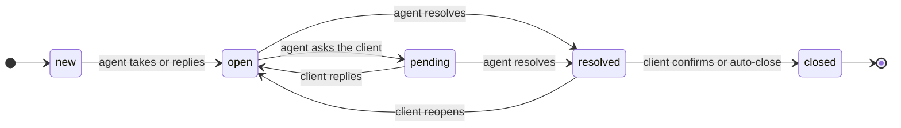

# Ticket state machine

Every ticket follows a validated state machine. Status values are stored in English
in the database; the user interface shows them translated.

## Diagram

## States

| Status | UI label (es) | Meaning | Resolution clock |
|---|---|---|---|
| `new` | Nuevo | Created, not yet handled by an agent. | Running |
| `open` | Abierto | An agent is working on it. | Running |
| `pending` | En espera del cliente | Waiting for information from the client. | Paused |
| `resolved` | Resuelto | The agent considers it solved. | Paused |
| `closed` | Cerrado | Final state. A recurring problem becomes a new ticket. | Stopped |

## Transitions

| From → To | Who | Effects |
|---|---|---|
| `new` → `open` | Agent or admin; automatic on the first public agent reply | Assigns the agent if the ticket is unassigned. |
| `open` → `pending` | Agent or admin | Pauses the resolution clock: `sla_paused_at = now()`. |
| `pending` → `open` | Automatic when the client comments; also agent | Resumes the clock: extends `resolution_due_at` by the paused business minutes and clears `sla_paused_at`. |
| `open` → `resolved` | Agent or admin | Sets `resolved_at` and pauses the clock. |
| `pending` → `resolved` | Agent or admin | Adds the paused time to the deadline before setting `resolved_at`; the clock stays stopped. |
| `resolved` → `open` | Client (reopens) or agent | Extends the deadline by the time spent in `resolved`, clears `resolved_at` and `sla_paused_at`. |
| `resolved` → `closed` | Client (confirms) or system after 7 days | Sets `closed_at`. Auto-close runs as a background job with no actor. |

Any other combination is rejected as an invalid transition (HTTP 409).
Every transition records a `status_changed` event in `ticket_event`.

## SLA rules

- **When the clock runs.** The resolution clock runs only in `new` and `open`. It is
  paused in `pending` and `resolved`, so agents are not penalized while waiting for
  the client.
- **First response.** The first public comment written by an agent. Internal notes do
  not stop this clock.
- **Deadline calculation.** On creation, the policy duration is added in business
  minutes to the creation time, using the client's calendar. A ticket created outside
  business hours starts counting at the next working slot.
- **Priority change.** The difference between the new and the old duration is applied,
  in business minutes, to the current deadlines, so pauses already accumulated are kept.
- **Compliance.** A response is compliant if `first_response_at <= first_response_due_at`,
  and a resolution if `resolved_at <= resolution_due_at`. Since deadlines already include
  pauses, the dashboard only needs to compare columns.
- **Alerts.** A background job checks tickets with a running clock every minute and
  raises a `warning` alert at 80% of the deadline and a `breached` alert when it expires.

## Implementation

All transitions go through a single service function,
`transition(ticket, to_status, actor)`. Inside one database transaction it:

1. Locks the ticket row with `select_for_update()`.
2. Checks the allowed transitions table and the actor's role.
3. Updates timestamps and SLA deadlines.
4. Records the event.

The transitions table lives in code rather than in the database: it is explicit,
needs no extra dependency and can be tested exhaustively with a parametrized test over
every status pair and role.
