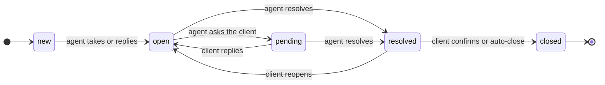

# Ticket state machine

Every ticket follows a validated state machine. Status values are stored in English
in the database; the user interface shows them translated.

## Diagram

## States

| Status | UI label (es) | Meaning | Resolution clock |
|---|---|---|---|
| `new` | Nuevo | Created, not yet handled by an agent. | Running |
| `open` | Abierto | An agent is working on it. | Running |
| `pending` | En espera del cliente | Waiting for information from the client. | Paused |
| `resolved` | Resuelto | The agent considers it solved. | Paused |
| `closed` | Cerrado | Final state. A recurring problem becomes a new ticket. | Stopped |

## Transitions

| From → To | Who | Effects |
|---|---|---|
| `new` → `open` | Agent or admin; automatic on the first public agent reply | Assigns the agent if the ticket is unassigned, with an `assignee_changed` event. |
| `open` → `pending` | Agent or admin | Pauses the resolution clock: `sla_paused_at = now()`. |
| `pending` → `open` | Automatic when the client comments; also agent | Resumes the clock: extends `resolution_due_at` by the paused business minutes and clears `sla_paused_at`. |
| `open` → `resolved` | Agent or admin | Sets `resolved_at` and `resolution_business_minutes`, and pauses the clock. |
| `pending` → `resolved` | Agent or admin | Adds the paused time to the deadline before setting `resolved_at` and `resolution_business_minutes`; the clock stays stopped. |
| `resolved` → `open` | Client (reopens) or agent | Extends the deadline by the time spent in `resolved`, clears `resolved_at`, `resolution_business_minutes` and `sla_paused_at`. |
| `resolved` → `closed` | Client (confirms) or system after 7 days | Sets `closed_at` and clears `sla_paused_at`: the clock is stopped for good, not paused, and the deadline is not extended. Auto-close runs as an hourly background job with no actor (`AUTO_CLOSE_AFTER`, 7 calendar days), one transaction per ticket; it checks the status and `resolved_at` again on the locked row and skips tickets locked by someone else. |

Any other combination is rejected with `409 Conflict`. A transition that exists but
is not allowed for the actor's role is rejected with `403 Forbidden` (see ADR-0003).
Every transition records a `status_changed` event in `ticket_event`.

## SLA rules

A summary; the full rules, with examples, are in [`sla.md`](sla.md).

- **When the clock runs.** The resolution clock runs only in `new` and `open`. It is
  paused in `pending` and `resolved`, so agents are not penalized while waiting for
  the client.
- **First response.** The first public comment written by an agent. Internal notes do
  not stop this clock. The business minutes consumed until then are stored in
  `first_response_business_minutes`.
- **Deadline calculation.** On creation, the policy duration is added in business
  minutes to the creation time, using the client's calendar. A ticket created outside
  business hours starts counting at the next working slot.
- **Priority change.** Staff can change the priority in `new`, `open` and `pending`. The
  difference between the new policy's resolution duration and the ticket's
  `resolution_target_minutes` (what was promised to this ticket, not the policy's current
  value) is applied, in business minutes, to `resolution_due_at`, so pauses already
  accumulated are kept. The first response deadline is computed again from `created_at`,
  since that clock never pauses; once the first response has happened it is not touched.
  A deadline that has already been breached never moves, as with calendar changes:
  lowering the priority cannot erase a breach. For a paused ticket, "breached" is judged
  at `sla_paused_at`, when its clock stopped. In `resolved` the priority is locked (409):
  the resolution has been measured; reopen the ticket first. A closed ticket cannot be
  changed at all.
- **Calendar changes.** If a holiday is added, working hours or the time zone change, or
  an organization switches calendars, the remaining business time of tickets with a
  running or paused clock is projected again with the new calendar, from now (running) or
  from `sla_paused_at` (paused). Expired deadlines are never modified. It happens in the
  same transaction as the change, with an `sla_recalculated` event per ticket. See
  ADR-0002 and ADR-0005.
- **Business minutes of the resolution.** Each ticket stores `resolution_target_minutes`,
  copied from its policy on creation. Since the deadline already includes every pause,
  the business minutes consumed are `target - business minutes left until the deadline`,
  negative "left" included when the deadline has passed. No running total of pauses is
  stored.
- **Compliance.** A response is compliant if `first_response_at <= first_response_due_at`,
  and a resolution if `resolved_at <= resolution_due_at`. Since deadlines already include
  pauses, the dashboard only needs to compare columns.
- **Alerts.** A background job checks tickets with a running clock every minute and
  raises a `warning` alert at 80% of the deadline and a `breached` alert when it expires.

## Implementation

All transitions go through a single service function,
`transition(ticket, to_status, actor)`, exposed in the API as
`POST /api/tickets/{id}/transitions/`. Inside one database transaction it:

1. Locks the ticket row with `select_for_update()`.
2. Checks the allowed transitions table and the actor's role.
3. Updates timestamps and SLA deadlines.
4. Records the event.

The transitions table lives in code rather than in the database: it is explicit,
needs no extra dependency and can be tested exhaustively with a parametrized test over
every status pair and role.
